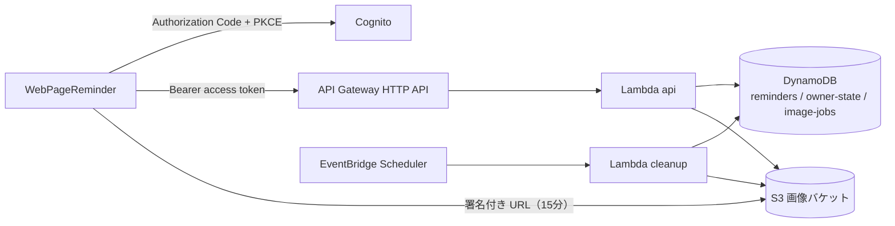

# reminder-server

Chrome 拡張機能 [WebPageReminder](https://github.com/Knu334/WebPageReminder) のリマインダーを保存・同期する API である。利用者ごとにリマインダーを1件単位で作成、取得、更新、削除し、サムネイル画像を保存する。

## 構成



- 本番環境は production の1つだけである。AWS の構成は Terraform の3つの root（`infra/bootstrap`、`infra/platform`、`infra/application`）で定義する。
- Lambda は Node.js 24 の ZIP で、1つの ZIP に `api` と `cleanup` の2つの handler を入れる。
- 画像の清掃（`cleanup`）は毎日 03:00 UTC に動く。初期状態は無効である。
- このリポジトリはローカルで HTTP を listen する起動 script を持たない。動作は試験と、AWS のエミュレーター Floci で確かめる。

## 必要なもの

| ツール | 版 |
| --- | --- |
| Node.js | 24.21.0 |
| npm | 11.11.1 |
| Python | 3.13.16（`uv python install 3.13.16` で導入できる） |
| Terraform | 1.16.5（AWS provider 6.67.0） |
| Floci | `npm test` の正式 E2E に必要。開発コンテナで起動する（[手順](docs/operations/formal-e2e-README.md)） |

開発コンテナ（`.devcontainer`）を使うと、Floci も含めて準備できる。

## はじめかた

```sh
npm ci
npm run typecheck
npm run lint
npm run build
npm run package     # artifacts/reminder-server.zip を作る
npm run test:offline
```

`npm run test:offline` は Floci を使わない試験である。ZIP を検査する試験があるので、先に `build` と `package` を実行する。

Floci を起動した環境では、次のコマンドで offline 試験と正式 E2E をまとめて実行する（約15分）。

```sh
npm test
```

## 変更の確認

変更を commit する前に、次のコマンドを順に実行する。CI の `ci.yml` もほぼ同じ内容を実行する。

```sh
npm ci
npm run typecheck
npm run lint
npm run build
npm run package
npm run verify:zip
npm test            # Floci が無い環境では npm run test:offline
npm run test:packaging
npm run infra:check
npm run audit:runtime
npm run audit:all
npm sbom --sbom-format cyclonedx > artifacts/sbom.json
```

## 主なコマンド

| コマンド | 内容 |
| --- | --- |
| `npm test` | `test:offline` の後に Floci の正式 E2E（`test:e2e:floci`）を実行する。Floci が無いと exit 2 |
| `npm run test:offline` | runtime、operations、delivery、結合試験、E2E の harness 試験。Floci は不要 |
| `npm run test:runtime` / `test:operations` / `test:delivery` | 個別の試験群 |
| `npm run typecheck` / `lint` | TypeScript の型検査と ESLint |
| `npm run build` / `package` / `verify:zip` | bundle、再現可能な ZIP の作成、ZIP の検証 |
| `npm run test:packaging` | ZIP 作成（Python）の試験 |
| `npm run infra:check` | 3つの Terraform root の init、validate、mock 試験、fmt。AWS の認証は不要。`-- --root=bootstrap` で1つに絞れる |
| `npm run audit:runtime` / `audit:all` / `sbom` | 依存関係の audit と CycloneDX の SBOM。High 以上で失敗する |

本番の操作に使うコマンド（`release:*`、`migrate:json`、`recovery:verify`）は、[deployment 手順](docs/operations/deployment.md)、[移行手順](docs/operations/migration.md)、[復旧手順](docs/operations/recovery.md)にある。

## ディレクトリ構成

| パス | 内容 |
| --- | --- |
| `src/` | Lambda の handler（`api.ts`、`cleanup.ts`）と、API、リマインダー、画像、清掃の実装 |
| `scripts/build/` | bundle と ZIP の作成、検証 |
| `scripts/release/` | ZIP の登録、Terraform plan の照合、release の検証、GHA 用の helper |
| `scripts/operations/` | JSON からの移行と、PITR 復旧の検証 |
| `scripts/e2e/` | 正式 E2E の runner |
| `infra/` | Terraform の3つの root |
| `tests/` | 試験と合成の fixture |
| `docs/` | 仕様と運用手順 |

## CI/CD

| workflow | 起動 | 内容 |
| --- | --- | --- |
| `ci.yml` | PR、`main` への push | 型検査、lint、試験、ZIP の作成と検証、`infra:check`、audit |
| `floci-e2e.yml` | `main` への push | JVM 版の Floci を起動し、`npm test` を実行する |
| `deploy.yml` | 手動 | 実 AWS への ZIP 登録、Terraform の plan と apply。`main` だけで動く。plan などは private な S3 に置く |

## API

認証は Cognito の access token（Bearer）で、読み取りは `reminder-api/read`、書き込みは `reminder-api/write` の scope が要る。

| メソッドとパス | 内容 |
| --- | --- |
| `GET /v2/reminders` | 一覧（cursor でページ送り） |
| `GET /v2/reminders/{id}` | 1件の取得 |
| `GET /v2/reminders/{id}/thumbnail-url` | 画像の署名付き URL |
| `POST /v2/reminders` | 作成 |
| `PATCH /v2/reminders/{id}` | 更新（`If-Match` が必須） |
| `DELETE /v2/reminders/{id}` | 削除（`If-Match` が必須） |
| `GET /healthz` / `GET /readyz` | 死活監視（認証は不要） |

DTO、エラー、上限は [API v2 仕様](docs/api-v2.md)、拡張機能の認証は [Chrome 拡張機能の Cognito 認証](docs/chrome-extension-cognito-auth.md)にある。設定項目は [.env.example](.env.example) にある。これは `loadConfig` が読む環境変数の公開サンプルで、dotenv による自動読み込みはしない。

## 文書

| 文書 | 内容 |
| --- | --- |
| [API v2 仕様](docs/api-v2.md) | エンドポイント、DTO、エラー、上限 |
| [Chrome 拡張機能の Cognito 認証](docs/chrome-extension-cognito-auth.md) | Hosted UI、PKCE、token の更新 |
| [deployment 手順](docs/operations/deployment.md) | GHA による登録、plan、apply と rollback |
| [移行手順](docs/operations/migration.md) | 旧 JSON からの移行 |
| [復旧手順](docs/operations/recovery.md) | DynamoDB の PITR 復旧 |
| [画像の清掃](docs/operations/cleanup.md) | 日次と手動の清掃 |
| [受け入れ記録](docs/operations/acceptance.md) | 受け入れの手順と記録 |
| [seed 手順](infra/application/production/README.md) | 初回構築の API seed |
| [正式 E2E 手順](docs/operations/formal-e2e-README.md) | Floci での E2E の実行方法 |
| [正式 E2E の結果](docs/operations/formal-e2e-results.md) / [限界](docs/operations/formal-e2e-limitations.md) | E2E の実測結果と、検証していないこと |
| [実装結果](docs/implementation-results.md) | 実装と検証の記録 |
| [料金の見積もり](docs/aws-cost-estimate-2026-10-02.md) | AWS 費用の予算係数（実測ではない） |

設計と実装計画は `docs/superpowers/` にある。

## 開発上の注意

- 私有の `.env`、Terraform の state と plan、mapping、画像、backup は Git に入れない。公開の `.example` を使う。
- 開発エージェント向けの指示は [CLAUDE.md](CLAUDE.md) にある。

## ライセンス

[MIT](LICENSE)
